<p align="center">
  
</p>

<p align="center">
  <a href="https://github.com/ishandutta2007/Awesome-Awesome-Awesome"></a><a href="https://discord.gg/jc4xtF58Ve"></a>
  <a href="https://github.com/ishandutta2007/Awesome-Patent-Discovery-Infringement-Forensics/stargazers"></a>
  <a href="https://github.com/ishandutta2007/Awesome-Patent-Discovery-Infringement-Forensics/network/members"></a>
  <a href="https://opensource.org/licenses/MIT"></a>
  <a href="http://makeapullrequest.com"></a>
  <a href="https://github.com/ishandutta2007"></a>
</p>

---

# ⚖️ Awesome Patent Discovery & Infringement Forensics

> **A curated directory of enterprise SaaS platforms, AI-assisted claim charting software, patent intelligence engines, and open-source forensic toolchains for prior art search, infringement detection, IP portfolio management, and freedom-to-operate (FTO) analysis.**

**Patent Discovery & Infringement Forensics** systems empower patent attorneys, corporate IP counsels, technology analysts, and R&D leaders to systematically evaluate global patent databases, unearth novelty-destroying prior art, deconstruct complex claim language, map claims against potentially infringing commercial products, and manage multi-jurisdiction portfolios. Modern solutions fuse large-scale graph databases, dense semantic vector search, large language model (LLM) claim analysis, and real-time litigation tracking across primary patent authorities including the **USPTO**, **EPO**, **WIPO**, **CNIPA**, **JPO**, and **KIPO**.

---

## 📑 Table of Contents

- [🌐 Sector Overview & Market Dynamics](#-sector-overview--market-dynamics)
- [🏢 Enterprise SaaS Platforms Comparison](#-enterprise-saas-platforms-comparison)
- [💻 Open-Source Patent Tools & Forensic Stacks](#-open-source-patent-tools--forensic-stacks)
- [🏗️ Architectural Blueprint for Self-Hosted Patent Intelligence](#️-architectural-blueprint-for-self-hosted-patent-intelligence)
- [🤝 How to Contribute](#-how-to-contribute)
- [⭐ Star History](#-star-history)
- [💖 Support & Community](#-support--community)
- [⚖️ Disclaimer](#️-disclaimer)

---

## 🌐 Sector Overview & Market Dynamics

The global **Patent Analytics and Intellectual Property (IP) Management Software** market is valued between **$4.2 billion and $5.5 billion in 2025–2026** and is projected to expand beyond **$11.8 billion to $13.5 billion by 2033**, compounding at an annual growth rate (**CAGR**) of **12.5% to 14.2%**. Market growth is driven by surging international patent filings, high-stakes intellectual property litigation in frontier technologies (generative AI models, semiconductor packaging, clean energy, and CRISPR gene therapeutics), and the rapid enterprise transition toward automated claim chart construction and semantic prior art discovery.

The sector exhibits a **moderately concentrated structure in core enterprise data aggregations**—dominated by established multi-billion-dollar market leaders including Clarivate (Derwent, CPA Global), RELX (LexisNexis PatentSight), Questel (Orbit Intelligence), and Anaqua—paired with a **highly fragmented and rapidly innovating perimeter** where agile AI startups and open-source Model Context Protocol (MCP) toolchains disrupt traditional per-seat enterprise billing through open access datasets and local LLM workflows.

---

## 🏢 Enterprise SaaS Platforms Comparison

The table below presents leading commercial SaaS platforms for patent discovery, competitive landscaping, and infringement forensics, **sorted in descending order by company scale (valuation or annual revenue)**:

| Platform / Tool | Valuation / Revenue (Company Size) | Key Focus & Forensic Capabilities | Specific Starting Pricing | Free Tier / Trial Limits |
| :--- | :--- | :--- | :--- | :--- |
| **[LexisNexis PatentSight](https://www.lexisnexisip.com/)** | **~$92B+ Market Cap** / ~$11.5B Annual Rev *(Parent: RELX Group)* | Scientifically verified Patent Asset Index (PAI) benchmarking, Technology Relevance / Market Coverage scoring, Protégé AI assistant, and SEP licensing intelligence. | **Starts at $5,000/seat/year** *(PatentSight Essential tier; Enterprise packages range $18,000–$42,000/year)* | **7-day guided free trial** *(includes up to 50 search queries and basic portfolio benchmarking charts; requires work email; no permanent free tier)* |
| **[Clarivate Derwent & CPA Global](https://clarivate.com/)** | **~$9.5B+ Enterprise Value** / ~$2.6B Annual Rev *(NYSE: CLVT)* | Derwent Innovation full-text database (165M+ records across 75 jurisdictions), human-authored DWPI summaries, PatentStrength™ lapse risk algorithms, and global litigation tracking. | **Starts at $6,000/seat/year** *(Derwent Innovation Core; enterprise corporate multi-seat tiers range $20,000–$80,000+/year)* | **14-day enterprise trial** *(guided pilot access for qualified corporate/firm legal teams with up to 100 record export credits; no permanent free tier)* |
| **[Anaqua (AQX)](https://www.anaqua.com/)** | **~$3.0B Valuation** / ~$210M Annual Rev *(Nordic Capital & Astorg backed)* | Enterprise IP management platform covering the full lifecycle: AI-driven docketing automation, integrated foreign filing services, annuity management, and claim-to-product mapping. | **Starts at $12,000/year** *(AQX Starter deployment for boutique practices; mid-to-large corporate deployments start at $35,000+/year)* | **30-day sandbox pilot** *(dedicated evaluation environment provided to qualified corporate IP departments; no permanent free tier)* |
| **[Questel (Orbit Intelligence)](https://www.questel.com/)** | **~$1.4B Valuation** / ~$240M Annual Rev *(Eurazeo & IK Partners backed)* | Orbit Intelligence global patent search, Sophia AI assistant, automated claim deconstruction, chemical structure & sequence search, and 240+ trademark registry integrations. | **Starts at €3,600/year (~$3,900/year)** *(Orbit Express; Orbit Intelligence full analytical suite starts at €7,500/seat/year (~$8,100/seat/year))* | **14-day free trial** *(access to global patent database and analytics with up to 25 export credits; requires enterprise verification; no permanent free tier)* |
| **[Patsnap](https://www.patsnap.com/)** | **~$1.0B+ Valuation (Unicorn)** / ~$110M ARR *(SoftBank & Tencent backed)* | AI-powered innovation intelligence, 3D technology landscape clustering, automated claim infringement matrices, predictive risk analytics across 160+ jurisdictions, and chemical/bio R&D intelligence. | **Starts at $4,500/seat/year** *($375/month billed annually for Discovery Essential; Enterprise Infringement Suite starts at $15,000/year)* | **7-day free trial** *(full access to semantic search engine, basic citation graphs, and up to 30 patent record exports; no permanent free tier)* |
| **[RPX Corporation](https://www.rpxcorp.com/)** | **~$555M Valuation** / ~$240M Annual Rev *(Take-private by HGGC)* | Patent risk management, non-practicing entity (NPE) litigation defense analytics, patent transaction tracking, and defensive syndicate patent acquisitions. | **Starts at $10,000/year** *(RPX Insight data platform license; defensive patent aggregator membership starts at $60,000+/year based on company revenue)* | **14-day trial** *(restricted to qualified in-house corporate legal counsel upon credential review; no permanent free tier)* |
| **[Minesoft (PatBase)](https://minesoft.com/our-products/patbase/)** | **~$120M Valuation** / ~$25M Annual Rev *(Epiris backed)* | PatBase searchable database covering over 180M patent specifications, non-Latin text indexing, family legal status tracking, and automated citation mapping. | **Starts at $3,800/seat/year** *($315/month billed annually for PatBase Express; full PatBase Professional starts at $7,200/seat/year)* | **14-day fully functional trial** *(hands-on trial with access to 100 patent record downloads; no permanent free tier)* |
| **[IPlytics](https://www.iplytics.com/)** | **~$50M Valuation** / ~$15M Annual Rev *(LexisNexis / RELX division)* | Standard Essential Patent (SEP) declarations, standard contribution tracking (5G, Wi-Fi 6/7, VVC codecs), and claim-to-standard mapping algorithms with essentiality scoring. | **Starts at $8,000/seat/year** *(IPlytics Platform single analyst user license; corporate team licenses start at $22,000/year)* | **7-day trial** *(complimentary trial with access to 5 standard declaration analyses and semantic mapping previews; no permanent free tier)* |
| **[ktMINE](https://www.ktmine.com/)** | **~$30M Valuation** / ~$10M Annual Rev *(Dennemeyer Group subsidiary)* | Global IP licensing agreements, unredacted royalty rate benchmarking, patent transaction transfer data, and transfer pricing audit intelligence. | **Starts at $495/month ($5,940/year)** *(Search Portal; full Royalty Rate database starts at $1,200/month ($14,400/year))* | **7-day free trial** *(full database search access with up to 3 unredacted royalty agreement previews; no permanent free tier)* |
| **[GreyB](https://greyb.com/)** | **~$25M Valuation** / ~$12M Annual Rev *(GreyB Services)* | Custom patent invalidity searches, infringement claim charting, prior art discovery, and CIPAC competitive intelligence monitoring dashboards. | **Starts at $1,500/month ($18,000/year)** *(CIPAC continuous monitoring dashboard; on-demand prior-art / invalidity searches start at $3,500/study)* | **Preliminary screening report** *(complimentary initial novelty/invalidity screening including up to 3 prior-art references; no permanent free tier)* |
| **[The Lens (Cambia)](https://www.lens.org/)** | **~$8M Annual Budget** / Non-profit *(Cambia social enterprise)* | Open patent and scholarly literature search, biological sequence alignment in patent claims, citation mapping, and global patent family analysis. | **Free for non-commercial research; Commercial/Enterprise API starts at $1,500/year** *(billed annually; team enterprise tiers start at $4,800/year)* | **Free forever plan** *(unlimited public patent searches, up to 1,000 citation queries/month, and 50 saved collections; 14-day trial for Commercial API)* |

---

## 💻 Open-Source Patent Tools & Forensic Stacks

The open-source patent analytics ecosystem provides self-hostable pipelines for bulk data ingestion, semantic vector embedding, claim deconstruction, and infringement report generation. The repositories below are **sorted in descending order by GitHub star count**:

1. **[google/patents-public-data](https://github.com/google/patents-public-data)** [](https://github.com/google/patents-public-data/stargazers)  
   *Patent analysis using Google Patents Public Datasets on BigQuery.* Contains SQL notebooks and schema definitions for analyzing full-text bibliographic, citation, and machine-translated patent tables spanning 100+ global patent offices.

2. **[arktrail/Dorothy-Ymir](https://github.com/arktrail/Dorothy-Ymir)** [](https://github.com/arktrail/Dorothy-Ymir/stargazers)  
   *AI solution for multi-label patent classification and semantic analysis.* Uses deep NLP to automatically categorize patent claims into IPC/CPC classifications, detect functional relationships, and calculate conceptual similarity between patents.

3. **[iamlemec/fastpat](https://github.com/iamlemec/fastpat)** [](https://github.com/iamlemec/fastpat/stargazers)  
   *High-performance parser and clustering toolkit for USPTO patent data.* Ingests bulk patent applications, granted patents, assignments, and maintenance fee transactions into high-speed databases for quantitative IP litigation modeling.

4. **[parkerhancock/patent_client](https://github.com/parkerhancock/patent_client)** [](https://github.com/parkerhancock/patent_client/stargazers)  
   *Pythonic ORM-style client for public patent data.* Connects directly to the USPTO Open Data Portal, Patent Examination Data System (PEDS), Assignments, and EPO OPS with typed models, caching, and integrated export helpers.

5. **[AI-Growth-Lab/PatentSBERTa](https://github.com/AI-Growth-Lab/PatentSBERTa)** [](https://github.com/AI-Growth-Lab/PatentSBERTa/stargazers)  
   *Deep NLP hybrid model for patent semantic distance and classification.* Fine-tuned Sentence-BERT architecture trained specifically on patent claims and abstracts to calculate semantic similarity for prior art searches and invalidity investigations.

6. **[ip-tools/patzilla](https://github.com/ip-tools/patzilla)** [](https://github.com/ip-tools/patzilla/stargazers)  
   *Modular patent information research platform and IP data integration toolkit.* Features a modern web interface for patent screening, claim inspection, and multi-source API integration across EPO OPS, DPMA, and DEPATISnet.

7. **[cverluise/PatCit](https://github.com/cverluise/PatCit)** [](https://github.com/cverluise/PatCit/stargazers)  
   *Open-source patent citation and non-patent literature (NPL) parser.* Extracts and enriches non-patent literature references, DOI links, academic author profiles, and institutional affiliations from patent document front pages.

8. **[ip-tools/uspto-opendata-python](https://github.com/ip-tools/uspto-opendata-python)** [](https://github.com/ip-tools/uspto-opendata-python/stargazers)  
   *Python client library for the USPTO Open Data APIs.* Streamlines querying and retrieving published patent documents, patent term adjustments, PTAB trial dockets, and assignment records with rate-limit handling.

9. **[wenyalintw/Google-Patents-Scraper](https://github.com/wenyalintw/Google-Patents-Scraper)** [](https://github.com/wenyalintw/Google-Patents-Scraper/stargazers)  
   *Automated scraping and bulk download utility for Google Patents.* Fetches complete search result sets, resolves patent family members across jurisdictions, and downloads original PDF patent specifications.

10. **[patsnap/mcp](https://github.com/patsnap/mcp)** [](https://github.com/patsnap/mcp/stargazers)  
    *Official PatSnap Model Context Protocol (MCP) server.* Connects AI coding assistants (Claude Code, Cursor, Codex) to PatSnap's 200M+ global patent and scientific literature databases for automated prior art queries and R&D intelligence.

11. **[yuc16/PatentRadar](https://github.com/yuc16/PatentRadar)** [](https://github.com/yuc16/PatentRadar/stargazers)  
    *Agentic patent infringement analysis system.* Ingests target patent publication numbers, parses independent and dependent claims, conducts technical feature decomposition, and generates competitor infringement risk reports.

12. **[TamerKhraisha/uspto-patent-data-parser](https://github.com/TamerKhraisha/uspto-patent-data-parser)** [](https://github.com/TamerKhraisha/uspto-patent-data-parser/stargazers)  
    *Python engine for parsing USPTO Bulk Data Storage System (BDSS) files.* Efficiently processes massive multi-gigabyte XML archive files, extracting structured bibliographic headers, claim trees, descriptions, and citations.

13. **[jjdejong/phpip](https://github.com/jjdejong/phpip)** [](https://github.com/jjdejong/phpip/stargazers)  
    *Open-source patent and IP rights portfolio management and legal docketing system.* Complete PHP/MySQL application with automated EPO OPS patent family synchronization, renewal deadline tracking, and document merging.

14. **[nuri428/mcp_kipris](https://github.com/nuri428/mcp_kipris)** [](https://github.com/nuri428/mcp_kipris/stargazers)  
    *Model Context Protocol (MCP) server for KIPRIS Plus.* Enables autonomous AI agents to search patents across 13 countries through South Korea's KIPRIS international database by applicant, application number, or free text.

15. **[anubhavaanand/recon](https://github.com/anubhavaanand/recon)** [](https://github.com/anubhavaanand/recon/stargazers)  
    *Terminal-native TUI/CLI patent research and reconnaissance workstation.* Aggregates multi-source patent search across USPTO, Google Patents, WIPO, Lens.org, and EPO with ASCII citation trees, signal scoring, and Ollama AI integration.

---

## 🏗️ Architectural Blueprint for Self-Hosted Patent Intelligence

Organizations aiming to build an autonomous, sovereign IP analysis stack without incurring six-figure enterprise SaaS licensing fees can assemble an end-to-end pipeline leveraging the open-source tools featured in this repository:

```
┌─────────────────────────────────────────────────────────────────────────────────┐
│                           1. INGESTION & DATA LAYER                             │
│  ┌───────────────────────┐  ┌────────────────────────┐  ┌─────────────────────┐ │
│  │  google/patents-data  │  │ iamlemec/fastpat (XML) │  │ ip-tools/uspto-data │ │
│  │   (BigQuery 100M+)    │  │   (USPTO Bulk BDSS)    │  │  (EPO OPS / PEDS)   │ │
│  └───────────┬───────────┘  └───────────┬────────────┘  └──────────┬──────────┘ │
└──────────────┼──────────────────────────┼──────────────────────────┼────────────┘
               ▼                          ▼                          ▼
┌─────────────────────────────────────────────────────────────────────────────────┐
│                     2. EMBEDDING & SEMANTIC RETRIEVAL LAYER                     │
│  ┌───────────────────────────────────────────────────────────────────────────┐  │
│  │ AI-Growth-Lab/PatentSBERTa + Dense Vector Database (Qdrant / Milvus / PG) │  │
│  │   - Independent claim vectorization & element decomposition               │  │
│  │   - Semantic prior art nearest-neighbor matching                          │  │
│  └─────────────────────────────────────┬─────────────────────────────────────┘  │
└────────────────────────────────────────┼────────────────────────────────────────┘
                                         ▼
┌─────────────────────────────────────────────────────────────────────────────────┐
│                     3. INFRINGEMENT FORENSICS & REASONING                       │
│  ┌───────────────────────────┐                  ┌─────────────────────────────┐ │
│  │    yuc16/PatentRadar      │                  │ patsnap/mcp + nuri/kipris   │ │
│  │ (Automated Claim Charting │ ◄──────────────► │  (LLM Agent Orchestration   │ │
│  │  & Risk Matrix Generator) │                  │   via Claude / Gemini / AGY)│ │
│  └─────────────┬─────────────┘                  └─────────────────────────────┘ │
└────────────────┼────────────────────────────────────────────────────────────────┘
                 ▼
┌─────────────────────────────────────────────────────────────────────────────────┐
│                     4. DOCKETING & PORTFOLIO MANAGEMENT                         │
│  ┌───────────────────────────────────────────────────────────────────────────┐  │
│  │ jjdejong/phpip (Web UI, Renewal Deadlines, Office Actions, Family Trees)  │  │
│  └───────────────────────────────────────────────────────────────────────────┘  │
└─────────────────────────────────────────────────────────────────────────────────┘
```

---

## 🤝 How to Contribute

Contributions from patent attorneys, IP analysts, and legaltech software developers are warmly welcomed!

1. 🍴 **Fork the repository** to your personal GitHub account.
2. 🌿 **Create a feature branch** (`git checkout -b feature/add-new-patent-tool`).
3. 📝 **Add or update entries in `README.md`**:
   - Follow the established table or list formatting.
   - Include verified starting pricing, explicit free tier or trial parameters, and company valuation/revenue benchmarks.
   - For open-source tools, include the `style=social&color=white` badge linking directly to the repo's `/stargazers` page.
4. 🚀 **Commit your changes** (`git commit -m "Add <Tool-Name> to patent analytics list"`).
5. 📬 **Submit a Pull Request (PR)** with a clear rationale and verification links.

---

## ⭐ Star History

[](https://star-history.dera.page/#ishandutta2007/Awesome-Patent-Discovery-Infringement-Forensics&type=date&legend=top-left)

---

## 💖 Support & Community

Thank you for visiting and supporting **Awesome Patent Discovery & Infringement Forensics**! If you find this curated resource valuable for your patent strategy, prior art searches, and legaltech workflows:

- ⭐ **Star this repository** to help other patent attorneys, analysts, and researchers discover it.
- 🍴 **Fork and contribute** to keep entries accurate, comprehensive, and up to date.
- 📢 **Share** with your network across Twitter/X, LinkedIn, and IP law communities.
- ☕ **Sponsor the Project**: If you would like to support continuous curation and legaltech open-source development, please consider sponsoring via the [GitHub Sponsor Dashboard](https://github.com/sponsors/ishandutta2007).

---

## ⚖️ Disclaimer

- This repository is a **community-curated informational resource** and does not constitute formal legal advice or an attorney-client relationship.
- AI-generated patent validity assessments, freedom-to-operate (FTO) screenings, and infringement claim charts are for preliminary research only; all formal legal opinions must be conducted and certified by qualified patent attorneys admitted in the relevant jurisdiction.
- All product names, logos, trademarks, and registered trademarks cited herein are property of their respective owners. Commercial pricing and trial terms are subject to change by vendors.
